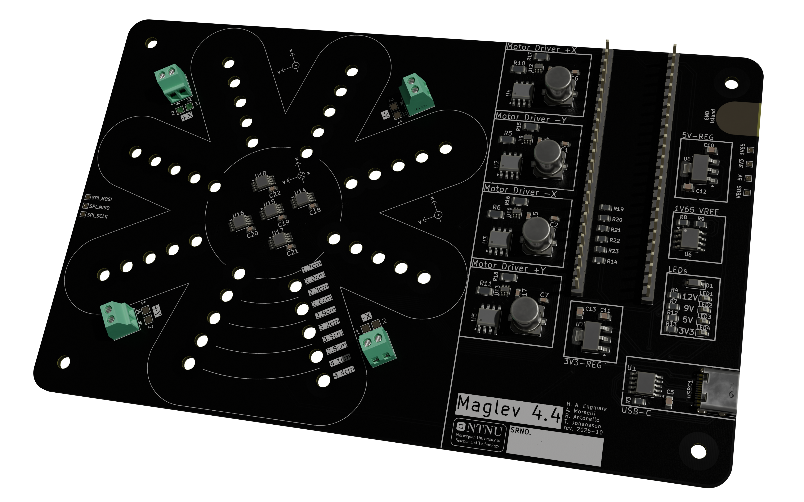

<h1 align="center">Maggy Hardware 🧲</h1>

<strong>Schematic, PCB layout and part libraries for the Maggy maglev lab.</strong>

This repository contains the KiCad design files for the Maggy PCB. For an introduction to the project as a whole, the lab material and the other repositories, see the [Maggy organisation page](https://github.com/Maggy-the-maglev-lab).

## Ordering Boards

You do not need to install KiCad to order boards. Each board revision has a [release](https://github.com/Maggy-the-maglev-lab/maggy-design/releases) with the Gerbers, drill files, BOM, CPL and a PDF of the schematic, ready to upload to JLCPCB. Board options and parts bought separately (such as the Teensy 4.1) are listed in [ordering.md](./documentation/ordering.md).

Releases are tagged `vMAJOR.MINOR.PATCH`, where `MAJOR.MINOR` matches the revision printed on the silkscreen. A suffix such as `-rc.1` marks a release candidate. In this state, expect minor changes to the revision before its final release. 

## Development

Maggy is designed with [KiCad](https://www.kicad.org/).

The rest of the repository is laid out as follows:

- **[libs/](./libs)** contains project-specific symbols and footprints, loaded automatically through the project library tables.
- **[documentation/](./documentation)** is reserved for design decisions and notes that are too long to fit on the schematic.

Fabrication files are generated with the [kicad-jlcpcb-tools](https://github.com/Bouni/kicad-jlcpcb-tools) plugin and attached directly to each release. 

## Contributing

This repo's `master` branch is protected, so changes must happen through a pull request. Every release, a part of the release notes is automatically generated from these pull requests and helps keep an organized overview of the changes to the project. 

1. For *contributors* with direct access to this repository: Branch off `master`, using a `feature/`, `fix/` or `chore/` prefix.
   
   If you wish to contribute but are not part of this organization: Create a fork of this repository, and implement your changes there. 

2. Write commits as [Conventional Commits](https://www.conventionalcommits.org). Try to always explain include information about *why* you made the change in the commit body, not only *what* changed.
3. When your changes are ready, open a pull request. You should ensure that you don't have any ERC or DRC errors before doing so. 

Where possible, record design decisions next to the design. In decreasing priority, this would be silkscreen elements, short notes as text on the schematic, and anything longer in [documentation/](./documentation).

## Development History 🚀

| **Version** | **Developer**                                                  | **Goal**                                                      | **Development period** |      **Status**      | **Result**                  |
| ----------- | -------------------------------------------------------------- | ------------------------------------------------------------- | ---------------------- | :------------------: | --------------------------- |
| V1.0        | M. Brønstad   J. O. Deila   J. Dyrskog   M. Langklopp | Levitaion                                                     | Spring 2022            |          ✅          | Stable levitation ~ 2 min   |
| V2.0        | M. Brønstad   J. O. Deila   J. Dyrskog                   | Smaller form factor, more robust                              | Summer 2022            |          ✅          | Stable levitation >> 2 min  |
| V2.5        | JH Technical AS                                                | Fix minor bugs, improve heating and components                | Spring 2024            |          ✅          | Stable levitation >> 2 min  |
| V2.6        | A. Morselli                                                    | Fix faulty wiring, changing sensors                           | Spring 2024            |          ✅          | Stable levitation >> 30 min |
| V2.7        | A. Morselli                                                    | Modular design and testbench for V3.0                         | Spring 2024            |          ✅          | Decisions on design         |
| V3.0        | A. Morselli                                                    | Modular redesign for first 'Take-home lab'                    | Summer 2024            |          ✅          | Decisions on design         |
| V3.1        | M. Leroux                                                      | Adding USB-C power                                            | Fall 2024              |          ✅          | Improved power delivery     |
| V4.0        | M. Leroux                                                      | New form factor and additional sensing for improved stability | Fall 2024              |          ✅          | Improved control            |
| V4.1        | R. Antonello                                                   | Rerouting PCB tracks and updating components                  | Spring 2025            |          ✅          | Meets IPC standards         |
| V4.2        | K. Blom                                                        | Creating a MISO version of the board                          | Spring 2025            |          ✅          | MISO board                  |
| V4.3        | A. Morselli                                                    | Improving EM compatibility via some rerouting                 | Fall 2025              |          ✅          | Improved EM compatibility   |
| V4.4        | T. Johansson                                                   | KiCad migration, SPI sensors                 | Fall 2026              |          🚧          | In testing (`v4.4.0-rc.2`)  |

Theses and project reports from previous contributors are listed in [Take-home-Maglev-lab](https://github.com/Hansolini/Take-home-Maglev-lab).

## Licence

<!-- TODO: choose a hardware licence, e.g. CERN-OHL-S-2.0, and add a LICENSE file -->
To be decided.
